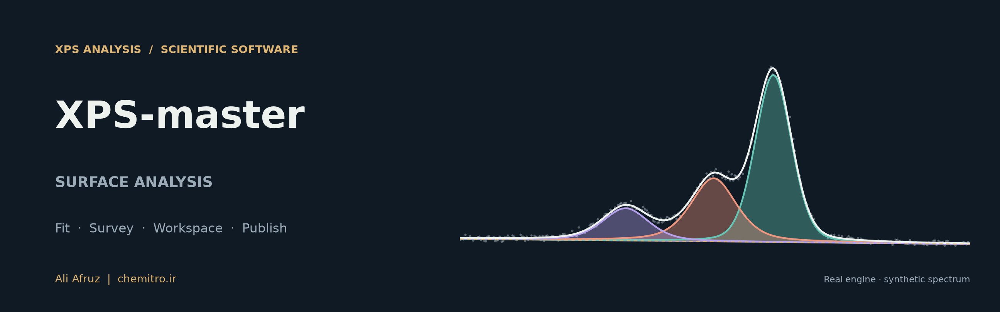
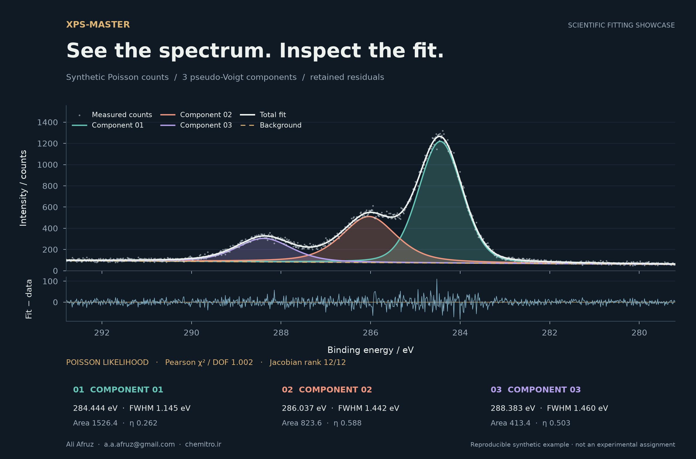
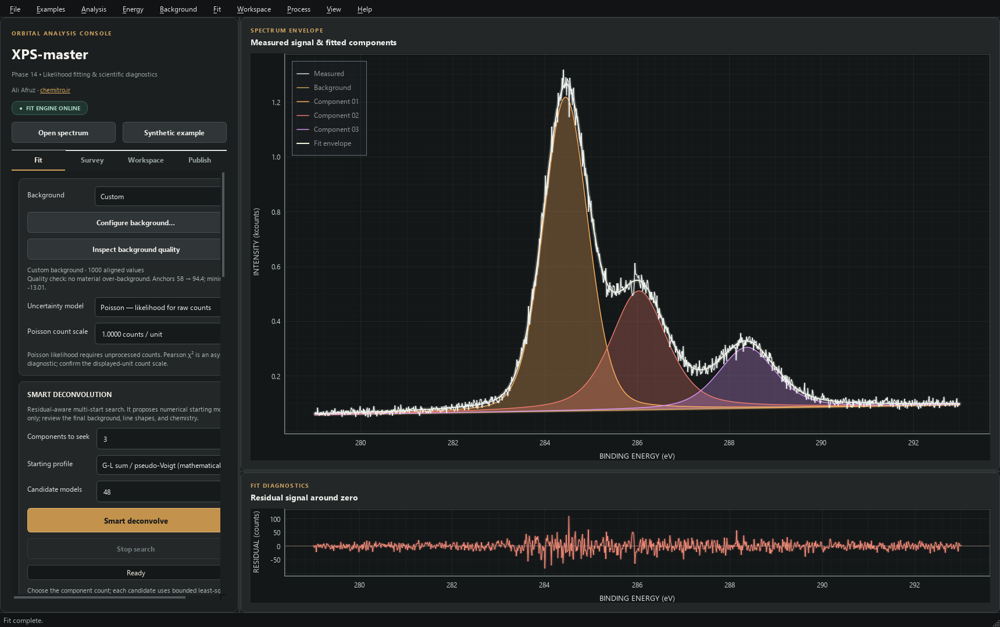
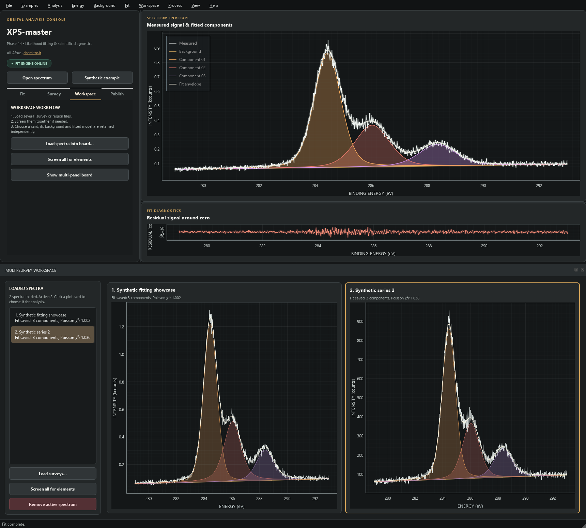

# XPS-master



<p align="center">
  
  
  
  
</p>

**Reproducible X-ray photoelectron spectroscopy analysis, from spectrum to
publication figure.**

XPS-master brings constrained peak fitting, survey screening, model
evidence, a multi-spectrum workspace, and a publication plot editor into one
Python desktop application. Backgrounds, constraints, calibration history, and
retained results remain inspectable.

**Created and maintained by Ali Afruz** ·
[a.a.afruz@gmail.com](mailto:a.a.afruz@gmail.com) ·
[chemitro.ir](https://chemitro.ir)

Source repository: [AliAfruz/XPS-Master](https://github.com/AliAfruz/XPS-Master).

## Fitting showcase



*Synthetic Poisson-count data fitted by the actual XPS-master engine. Curves,
residuals, and reported parameters come from the numerical fit. Component labels
do not imply chemical-state assignments.*

Reproduce this figure with [`examples/create_showcase.py`](examples/create_showcase.py).
The [fit provenance](docs/assets/showcase-fit.json) records the seed, model,
background, weighting, and fitted values.

## What you can do

| Workflow | Included tools |
|---|---|
| **Fit** | Bounded peak models, linked spin-orbit doublets, multiple line shapes, explicit backgrounds, residuals, and uncertainty diagnostics. |
| **Survey** | Element candidates, companion-line and overlap checks, scoped weak-line recovery, and editable RSF composition previews. |
| **Workspace** | Multiple spectra with retained models, results, calibration, processing provenance, and complete `.xpsa` sessions. |
| **Evidence** | Smart deconvolution, Stability-Consensus Trust Reports, controlled model comparison, and global multi-spectrum fitting. |
| **Publish** | Complete Excel workbooks and the integrated Manuscript Plotter with PNG, TIFF, PDF, SVG, templates, and batch export. |

### Inside the desktop application



<details>
<summary>View the multi-spectrum workspace</summary>



</details>

## Install and launch

Python **3.10 or newer** is required; Python 3.12 is a convenient development
choice. Install into a virtual environment from this repository's root.

### Windows

```powershell
py -3.12 -m venv .venv
.\.venv\Scripts\python.exe -m pip install --upgrade pip
.\.venv\Scripts\python.exe -m pip install -e .
.\.venv\Scripts\python.exe run.py
```

After installation, double-click **`run.bat`** or run the installed desktop
command **`xps-master`** from the environment. Activation is optional.

### Linux / macOS

```bash
python3 -m venv .venv
source .venv/bin/activate
python -m pip install --upgrade pip
python -m pip install -e .
python run.py
```

The desktop requires a graphical session. The Manuscript Plotter additionally
uses Tk. Automated GUI validation currently targets Windows Python 3.10/3.12;
other desktop environments should be checked locally.

## First analysis

1. Open a CSV/TSV/text or Thermo/VG `.VGD` spectrum, or load the synthetic example.
2. Select an ROI and inspect calibration and the chosen background.
3. Add components or constrained doublets; review profiles, bounds, and ties.
4. Fit and inspect residuals, uncertainty, correlation, and boundary warnings.
5. Compare models or fit a related series globally when the hypothesis warrants it.
6. Save the complete `.xpsa` session, export Excel, and prepare figures in **Publish**.

The [detailed user guide](docs/user_guide.md) explains survey scope, processing,
charge correction, model dashboards, project recovery, and publication controls.

## Scientific methods

Version 0.2.0 includes analytic common-profile derivatives, scaled optimization,
raw-count Poisson maximum likelihood, propagated tie bounds, SVD/Fisher local
uncertainties, and likelihood-consistent AICc/BIC.

Uniform mode reports RSS and residual RMS. Poisson mode fits count deviance,
including zero-count channels, and reports Pearson chi-square separately.
Fixed backgrounds and selected profiles remain explicit model assumptions.
Local errors and model support do not establish chemical identity.

Read the [scientific methods](docs/scientific_methods.md),
[architecture](docs/architecture.md), and
[performance validation](docs/performance_validation.md).

## Tests and reproducible examples

```shell
python -m pip install -e ".[dev]"
python -m pytest -q
python -m xps_afruz.examples.fit_synthetic
python examples/create_showcase.py
```

The last scientific validation passed **102 tests**, including known-truth
likelihood, constraints, covariance, project migration, Excel, and offscreen GUI
checks. The benchmark's common-profile synthetic cases measured **2.56–3.36x**
speed ratios; this is a workload-specific result, not a universal performance claim.

## Documentation and contribution

- [Detailed user guide](docs/user_guide.md)
- [Scientific methods and assumptions](docs/scientific_methods.md)
- [Code organization](docs/code_organization.md)
- [Release notes](CHANGELOG.md)
- [Contribution guide](CONTRIBUTING.md)
- [GitHub upload and release guide](docs/github_upload.md)
- [Zenodo release guide](docs/zenodo_release.md)

## Citation and license

Use [`CITATION.cff`](CITATION.cff) to cite the software in research. The project is
distributed under the [MIT license](LICENSE).

---

**Ali Afruz** · [a.a.afruz@gmail.com](mailto:a.a.afruz@gmail.com) ·
[chemitro.ir](https://chemitro.ir)
